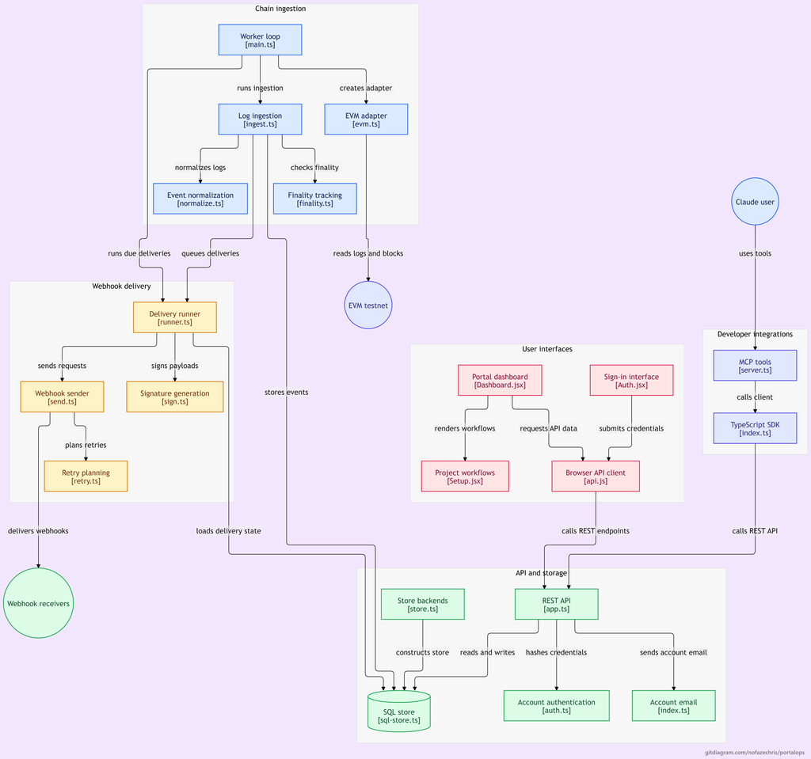
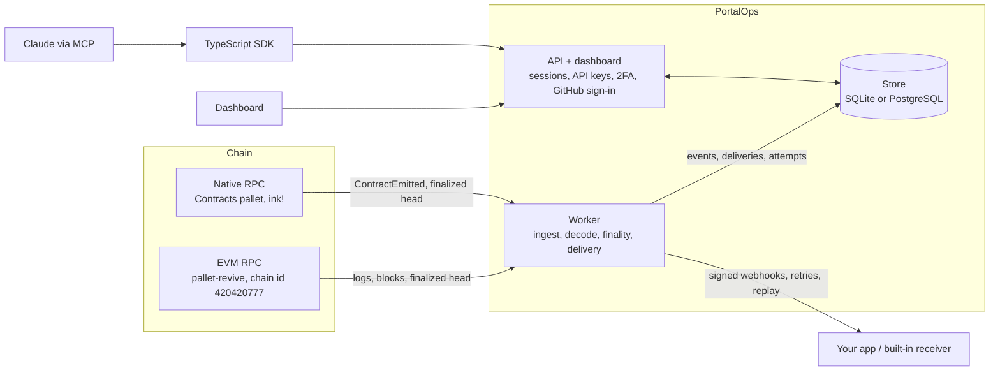

# PortalOps

**The event layer for Portaldot.** PortalOps watches smart contracts on the Portaldot V3.0 testnet, Solidity and Rust (ink!) alike, and delivers
every event to your app as a signed, retried, replayable webhook, with a dashboard, REST API, TypeScript SDK and a Claude (MCP) assistant on top.
Hackathon track: **Modular Cloud & Middleware**. Testnet only (EVM chain id `420420777`).

| | |
|---|---|
| Live app | https://portalops.onrender.com (free hosting that sleeps when idle: the first load can take up to a minute) |
| Try it, no signup | [Playground](https://portalops.onrender.com/playground) · [Arena Lab](https://portalops.onrender.com/arena) (interactive game challenges) · [public explorer](https://portalops.onrender.com/app) |
| Read | [Docs](https://portalops.onrender.com/docs) · [Pitch deck](https://portalops.onrender.com/pitch) ([PDF](https://portalops.onrender.com/pitch/portalops-pitch.pdf)) · [Walkthrough video](https://youtu.be/fau4mVZS1iY) |
| Packages on npm | [`@portalops/sdk`](https://www.npmjs.com/package/@portalops/sdk) · [`@portalops/mcp`](https://www.npmjs.com/package/@portalops/mcp) (`npx -y @portalops/mcp`) |

## The story, in two minutes

> Smart contracts are brilliant at doing things, and terrible at telling anyone about it.

**The problem.** Picture a game on Portaldot. A player finishes a quest, the contract pays out the reward, and then it does the one thing contracts do
to say "that happened": it emits an event. Your server is supposed to hear that, and act: email the player, unlock the next level, update the leaderboard.

What the chain actually hands you is hex. When we looked at the testnet's public events (32 contracts, 225 events, blocks 91,528 to 145,105), **not one was
readable** without the contract's ABI. And that is the easy part. Blocks get reorganised, so the chain can change its mind about what happened. Your server
goes down at 3 a.m. and misses the event. The webhook fails and nobody retries it. Every team that builds on Portaldot ends up writing the same plumbing,
slowly, differently, and with different bugs.

**What we built.** PortalOps is that plumbing, built once, for Portaldot, and left open for everyone. It does five things, in this order:

1. **Watch** the contracts you point it at, Solidity and Rust.
2. **Decode** raw logs into named events (`QuestCompleted`, not `0x70b9fa9d…`), and never invent a name it cannot prove.
3. **Confirm** how final each event is, straight from the node's own finalized head. No guessing.
4. **Deliver** it to your server as a signed webhook, with retries when you are down.
5. **Replay** anything you missed, without touching the chain again.

**Why Portaldot, specifically.** Portaldot runs two contract engines on one chain: an EVM for Solidity, and ink! for Rust. They report events in different
places, only about the last 256 blocks can be fetched by number, and deploying costs weight, not the gas you are used to. None of it is hard once you know.
All of it is a bad afternoon if you do not. So we wrote down what the network really does ([field notes](docs/architecture/network-compatibility.md)), and
built PortalOps around that, not around what a generic EVM chain would do.

**Why we think it should exist.** Because the next apps on Portaldot are games, payments and AI agents, and all of them live on one question: *what just
happened on the chain?* They should get the answer in minutes, not spend a week building an indexer. And because we would rather you did not take our word
for any of it. Every EVM event has a **Verify against the chain** button, and it runs in your own browser against the public RPC. A public
[registry of verified contracts](https://portalops.onrender.com/registry) proves that source code really is what runs at an address. One command
(`npm run verify:evidence`) re-checks everything we claim about our deployed contracts, without using our database.

**Try it in sixty seconds.** Open the [playground](https://portalops.onrender.com/playground), click **Send a free ping**, and watch a real transaction
go onto the testnet, get captured, decoded, finalized and delivered as a signed webhook. Then click **Verify against the chain** and ask the chain
yourself.

**What we will tell you before you ask.** It is testnet software on free hosting, with no outside users yet, and we have not deployed our own Rust
contract live (it needs about 420 tPOT locked). The full list is under [Honest limits](#honest-limits). Our view is that a judge who finds a limit in our
README before finding it in our demo trusts the rest of it more.

## Verify it yourself (5 minutes, no key, no trust needed)

Needs **Node 24 or newer** (`nvm use`, or install from nodejs.org). Works on Windows, macOS and Linux with plain `npm`.

```bash
git clone https://github.com/nofazechris/portalops.git && cd portalops
npm ci
npm test                      # 220+ automated tests: engine, store, API, SDK, MCP, receiver, security, ingestion, delivery, native reader
npm run verify:evidence       # re-checks every on-chain claim below against the PUBLIC testnet RPC (24 checks, read-only)
npm run verify:evidence -- --live https://portalops.onrender.com    # ...and that the live service really captured those events
```

`verify:evidence` does not read our database or trust our server: it asks the testnet for each deployment receipt, the code at each address, and
each transaction's event, and fails loudly if anything does not match. It also compiles the Solidity in this repository and checks that the code on chain
is **byte for byte** what that source produces, so source, artifact and deployment are tied together.

## What is on chain

Deployed by us on the **Portaldot V3.0 testnet**, then captured, decoded and delivered by PortalOps itself:

| Contract | Address | Deployed | Runtime code |
|---|---|---|---|
| `PortalQuest` | `0x274F8AbeCAa7FE3772A2cB92F67F2ed4A64bc649` | block 145,098, tx `0xe2590bb80b8d81067a1af092a76e5ee9ea22d9c277b0bf2da752813fc21f8a4d` | 2,162 bytes |
| `PortalPing` | `0x6a8705e4621dd87a261b1c5f97b73871616537ec` | block 152,078, tx `0xb6809eeee11d1b4a1a98113da824cfd763131028b4048608883ab3bdb8aee7b8` | 454 bytes |

(A reviewer who counts the `0x` prefix gets 2,163 and 455.)

| Transaction | Event | Block | Hash |
|---|---|---|---|
| `createQuest` | `QuestCreated` | 145,103 | `0xd267e8a0610c73a4f21e24d0d69319307e52346dc65ad2e72ed280a26630f17c` |
| `completeQuest` | `QuestCompleted` | 145,104 | `0x11a6d7a86de919ad2b5da0c5098e3904cf23683733d53ff30b13c86d6af1c4b3` |
| `issueReward` | `RewardIssued` | 145,105 | `0x999f0cb2a1c04bce8edcd2b1ac37a3f98408162277428ada87b56b5fed7d32fb` |
| `ping` ×3 | `Ping` | 152,082 · 152,146 · 152,148 | `0x2e603ac3…cfb`, `0xb6a45130…ed2ee`, `0xb57f0bb8…1096` (full hashes in [`evidence-ping.json`](docs/architecture/evidence-ping.json)) |

Records: [`deployment.json`](docs/architecture/deployment.json), [`deployment-ping.json`](docs/architecture/deployment-ping.json),
[`evidence.json`](docs/architecture/evidence.json). The Token, Bounty and Arena examples (and the Rust `portal_ping_ink`) are compiled and tested
but **not deployed by us**; we do not call them live. The compiled artifacts reproduce byte for byte (`npm run examples:build` leaves a clean git tree).

The **Rust (ink!) reader** was also run against the real testnet: it captured real `ContractEmitted` events (blocks 130,828 and 130,847) emitted by
another team's ink! contract, marked them finalized from the node's own finalized head, and their extrinsic hashes were confirmed inside the blocks.
They are stored undecoded because that contract's metadata is not ours; decoding is covered by tests against real ink! 5 metadata.

**What this gives the Portaldot ecosystem, how to check every claim, the honest limits, and the questions we expect:** [For the Portaldot ecosystem](docs/guides/ecosystem.md).

## What it does

1. **Watch**: register a contract (address plus ABI for Solidity, or SS58 address plus metadata for ink!) in the dashboard, API, SDK or by asking Claude.
2. **Decode**: raw logs become named, typed events with deterministic ids, so nothing is delivered twice; unknown events are kept raw, never given a guessed name.
3. **Know how final it is**: `included`, `confirmed`, `finalized` (only from the node's own finalized head) or `orphaned` after a reorganisation.
4. **Deliver**: HMAC-SHA256 signed webhooks with exponential-backoff retries (bounded parallelism) and a full attempt history.
5. **Replay**: re-send any stored event with the same id after you fix your server; the chain is never touched.
6. **Diagnose**: every failed delivery gets a rule-based cause, confidence and checklist; an optional AI explanation shows you exactly what it would send first.
7. **Verify**: any EVM event can be checked against the chain itself. The check runs in your browser against the public RPC (transaction, status, block hash, contract, topics, data), so you do not have to trust PortalOps.

Around it: a public read-only explorer, a no-signup playground, a **verified contract registry** (submit Solidity source; it is compiled and proven to equal the code on chain, then everyone gets the ABI, named events and live activity), **Arena Lab** (graded coding challenges plus a delivery simulator built on the same
retry rules), accounts with email verification, GitHub sign-in and two-factor sign-in, project API keys that expire, a documentation site and tutorials.

## How it fits together



*Generated from this repository with [gitdiagram](https://gitdiagram.com/nofazechris/portalops). It shows the core path (chain, ingestion, finality, delivery, API,
store, dashboard, SDK and Claude tools). It predates the Rust (ink!) reader and the verified contract registry; both are described in
[the architecture overview](docs/architecture/overview.md).*

## Run it locally

```bash
npm install
# create a git-ignored .env with WEBHOOK_ENCRYPTION_KEY=<64 hex> (every variable: docs/reference/environment.md)
node -e "console.log('WEBHOOK_ENCRYPTION_KEY=' + require('crypto').randomBytes(32).toString('hex'))" > .env
npm run api                 # REST API on :8787
npm run worker              # block ingestion + webhook delivery
npm run dev                 # web app on :5173 (proxies /api to :8787)
```

Open http://localhost:5173. Without an account you get a read-only public explorer of live testnet events.

## Scripts

| Command | What it does |
|---|---|
| `npm test` | The full automated suite (checks the Node version first) |
| `npm run typecheck` | TypeScript check |
| `npm run verify:evidence` | Verifies our on-chain claims against the public testnet RPC (add `-- --live <url>` to check the running service too) |
| `npm run preflight` | Read-only testnet compatibility probe (writes `docs/architecture/preflight-report.json`) |
| `npm run pipeline:test` | Real testnet logs → delivery → forced failure → retries → replay (local receiver) |
| `npm run examples:build` | Recompile the example contracts into `packages/examples/generated.json` |
| `npm run contract:deploy` / `contract:interact` | Deploy and exercise a demo contract (dry run unless `-- --send`; needs a funded key in `.env`) |
| `npm run sdk:build` / `npm run mcp:build` | Compile the npm packages |
| `npm run db:backup` / `db:check` | Verified SQLite backup / check a `DATABASE_URL` |
| `npm run test:pg` | The store and API tests against a real PostgreSQL |
| `npm run security:scan` | Fails if any env file, key or secret is in the repo or its history (also a git hook and a CI step) |

## Layout

```
apps/api        REST API (node:http, zod, cookie sessions, rate limits, two-factor)
apps/worker     EVM and native (ink!) ingestion loops + bounded webhook delivery
packages/       database (SQLite or PostgreSQL), event-engine, webhook-engine, chain-adapters (EVM, native), diagnostics,
                examples, sdk (npm), mcp (npm), email, config, shared-types
contracts/      Solidity examples (evm/, examples/) and the Rust ink! example (ink/)
examples/       webhook receiver with failure injection
scripts/        deploy, preflight, evidence verification, security scan, ...
src/            React app (landing, docs, auth, dashboard, playground, Arena Lab)
docs/           the manual: guides, tutorials, API reference, architecture, security review, operations
```



The worker and the API share only the database. More in [docs/architecture/overview.md](docs/architecture/overview.md).

## For the Portaldot ecosystem

PortalOps is MIT licensed and built to be reused, not only demoed.

- **Packages anyone can install:** `@portalops/sdk` (typed client, webhook signature verification) and `@portalops/mcp` (Claude tools).
- **[Portaldot field notes](docs/architecture/network-compatibility.md):** what we learned about the testnet that is not in any announcement: pallet-revive account mapping and
  funding, weight-based gas, what the RPC keeps and prunes, real finality, and that the native node is an archive node.
- **Rust and Solidity examples** ready to deploy and watch: a quest board, token, bounty board, an Arena game and a Rust ping contract, each with a receiver snippet.
- **[Arena Lab](https://portalops.onrender.com/arena):** teaches idempotent, finality-aware, signature-verifying event handling with graded challenges, so the next game on Portaldot starts from correct habits.
- **Self-hostable:** one Docker image, SQLite or PostgreSQL, a Render blueprint ([docs/operations/live-deploy.md](docs/operations/live-deploy.md)). See [CONTRIBUTING.md](CONTRIBUTING.md).

## Documentation

Presenting or reviewing this project? The spoken [pitch script](docs/presentation/pitch-script.md), the [video script](docs/presentation/video-script.md) and
the [DoraHacks text](docs/presentation/dorahacks.md) are in `docs/presentation/`.

The full manual is in [docs/](docs/README.md): [quickstart](docs/guides/quickstart.md), [tutorials](docs/tutorials/index.md), [concepts](docs/guides/concepts.md)
(events, finality, deliveries, replay), [receiving webhooks](docs/guides/webhooks.md), [Rust (ink!) contracts](docs/guides/ink-contracts.md), [verified contracts](docs/guides/verified-contracts.md),
[game development](docs/guides/game-development.md), the [TypeScript SDK](docs/guides/sdk.md), [Set up with Claude](docs/guides/claude-setup.md), the
[REST API reference](docs/reference/api.md), [configuration](docs/reference/environment.md), [architecture](docs/architecture/overview.md),
[security review](docs/security/review.md) and [troubleshooting](docs/guides/troubleshooting.md). The API reference, the environment reference and every
link are checked by tests, so they cannot silently drift from the code.

## Honest limits

- **Testnet software.** No real funds are involved and it has not had an external security audit ([what was checked](docs/security/review.md)).
- **Free hosting** sleeps when idle; one instance watches one network. Account emails are only delivered when a Resend key is configured; AI
  explanations only when an Anthropic key is configured. Both are off by default and everything else works without them.
- **Native (ink!) decoding of a live contract** of ours is not shown yet: it needs a funded native account to deploy `contracts/ink/portal_ping_ink`.
  The reader, finality and reorg handling are verified against the live chain and real metadata, as above.
- **Not deployed by us:** the Token, Bounty and Arena examples.
- Webhooks are at-least-once; PortalOps makes duplicates harmless (stable event ids) rather than pretending exactly-once is possible over HTTP.

## License

[MIT](LICENSE).
