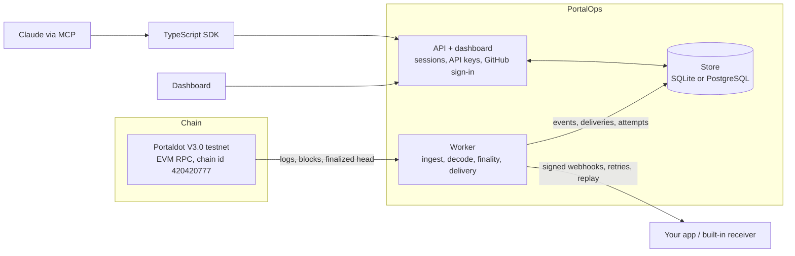

# PortalOps

Operational event layer for Portaldot applications: ingest on-chain events, deliver signed webhooks, retry, replay, monitor.
Targets the **Portaldot V3.0 testnet** (EVM chain id 420420777). See `docs/architecture/network-compatibility.md` for what has
and has not been verified against the real network.

**Try it:** [live app](https://portalops.onrender.com) · [playground (no signup)](https://portalops.onrender.com/playground) · [Arena Lab (interactive game challenges)](https://portalops.onrender.com/arena) ·
[docs](https://portalops.onrender.com/docs) · [pitch deck](https://portalops.onrender.com/pitch) ([PDF](https://portalops.onrender.com/pitch/portalops-pitch.pdf)).
Full walkthrough video: [youtu.be/fau4mVZS1iY](https://youtu.be/fau4mVZS1iY).
The live site runs on a free plan that sleeps when idle, so the first load can take up to a minute.

## Run locally

```bash
npm install
# create a git-ignored .env with WEBHOOK_ENCRYPTION_KEY=<64 hex> (every variable: docs/reference/environment.md)
node -e "console.log('WEBHOOK_ENCRYPTION_KEY=' + require('crypto').randomBytes(32).toString('hex'))" > .env
npm run api                 # REST API on :8787
npm run worker              # block ingestion + webhook delivery
npm run dev                 # web app on :5173 (proxies /api to :8787)
```

Open http://localhost:5173. Without an account you get a read-only public explorer of live testnet events.

## Scripts

| Command | What it does |
|---|---|
| `npm test` | 93 unit/integration tests (engine, store, API, receiver, security, ingestion, delivery) |
| `npm run typecheck` | TypeScript check |
| `npm run db:backup` | Verified online backup of the SQLite database |
| `npm run sdk:build` | Compile the TypeScript SDK (`packages/sdk`) to plain JS in `packages/sdk/dist` |
| `npm run preflight` | Read-only testnet compatibility probe |
| `npm run pipeline:test` | Real testnet logs → delivery → forced failure → retries → replay (local receiver) |
| `npm run contract:deploy` / `contract:interact` | Deploy + exercise the demo contract (dry-run unless `-- --send`; needs a funded key in `.env`) |

## Layout

```
apps/api        REST API (node:http, zod, cookie sessions, rate limits)
apps/worker     ingestion loop + delivery runner
packages/       database (SQLite store), event-engine, webhook-engine, chain-adapters, shared-types, sdk (API client)
contracts/evm   PortalQuest demo contract
examples/       webhook receiver with failure injection
src/            React app (landing, docs, auth, dashboard)
design/         original Claude Design files
```

## Guided setup, API keys and SDK

- **Guided setup** (dashboard → *Guided setup*): seven steps from an empty project to a verified delivery, each checked against the real
  network/API (RPC chain-id check, contract code check, one-time webhook secret, test delivery with signature confirmation).
- **API keys** (Settings → API keys): project-scoped `read`/`write` keys for servers and scripts; stored only as a SHA-256 hash, shown once, revocable.
- **TypeScript SDK** in `packages/sdk` (typed client, retries on reads, webhook verification). See its README. Not on npm yet.

## Testnet evidence

Deployed and exercised on the **Portaldot V3.0 testnet** (EVM chain id 420420777) on 2026-10-22:

| | |
|---|---|
| Contract | `PortalQuest` at `0x274F8AbeCAa7FE3772A2cB92F67F2ed4A64bc649` |
| Deployment transaction | `0xe2590bb80b8d81067a1af092a76e5ee9ea22d9c277b0bf2da752813fc21f8a4d` (block 145,098) |
| `createQuest` → `QuestCreated` | `0xd267e8a0610c73a4f21e24d0d69319307e52346dc65ad2e72ed280a26630f17c` (block 145,103) |
| `completeQuest` → `QuestCompleted` | `0x11a6d7a86de919ad2b5da0c5098e3904cf23683733d53ff30b13c86d6af1c4b3` (block 145,104) |
| `issueReward` → `RewardIssued` | `0x999f0cb2a1c04bce8edcd2b1ac37a3f98408162277428ada87b56b5fed7d32fb` (block 145,105) |
| Contract (2026-10-22) | `PortalPing` at `0x6a8705e4621dd87a261b1c5f97b73871616537ec`, one `Ping(from, seq, note)` event; source in `contracts/examples/PortalPing.sol` |
| Deployment transaction | `0xb6809eeee11d1b4a1a98113da824cfd763131028b4048608883ab3bdb8aee7b8` (block 152,078) |
| `ping("Hello from PortalOps — live demo")` | `0x2e603ac3d0b6219098060152af1b5253e38b86bd2bcd654f49d3cfc36ef30cfb` (block 152,082) |

The three events were read back with `eth_getLogs`, then captured, decoded and delivered by PortalOps itself. The contracts are written in
Solidity; see [network compatibility](docs/architecture/network-compatibility.md) for how Portaldot's EVM layer works.

## Documentation

The full manual is in [docs/](docs/README.md): [quickstart](docs/guides/quickstart.md), [concepts](docs/guides/concepts.md) (events, finality,
deliveries, replay), [receiving webhooks](docs/guides/webhooks.md) (Node, Python, Go, PHP), [contracts and examples](docs/guides/contracts-and-examples.md),
the [TypeScript SDK](docs/guides/sdk.md), the [REST API reference](docs/reference/api.md), [configuration](docs/reference/environment.md),
[architecture](docs/architecture/overview.md) and [troubleshooting](docs/guides/troubleshooting.md). The API reference, the environment
reference and every link are checked by tests, so they cannot silently drift from the code.

## Set up with Claude

`packages/mcp` is an MCP server that lets Claude register your contract, create a signed webhook, send a test delivery, show events and replay
failures. Secrets never enter the conversation: the API key stays in the server's environment and a webhook's signing secret is written
straight to a local env file. See [docs/guides/claude-setup.md](docs/guides/claude-setup.md); `npm run mcp` starts it over stdio.

## Architecture



The worker and the API share only the database. More in [docs/architecture/overview.md](docs/architecture/overview.md).

## Example contracts

The guided setup's **Add contract** step has a gallery of ready-made contracts (Quest board, Token, Bounty board). Each one gives you
its Solidity source, ABI, a deploy command, a description of every event with a sample payload, and a copy-paste webhook receiver.
`npm run examples:build` recompiles them into `packages/examples/generated.json`; deploy one with
`npm run contract:deploy -- --example token` (dry run) and add `--send` once the key in `.env` is funded.
The same catalog is served at `GET /api/v1/examples` and `GET /api/v1/examples/:id`.

## Deploying

- **Live on the internet (Neon + Render):** [docs/operations/live-deploy.md](docs/operations/live-deploy.md). `npm run db:check` verifies your
  `DATABASE_URL` first; `render.yaml` is the Blueprint; `scripts/start-all.mjs` runs the API and worker in one container.
- **Your own host:** `docker compose up -d --build` runs the API (which also serves the web app) and the worker on a shared SQLite volume, or
  add `-f docker-compose.postgres.yml` for PostgreSQL. See [docs/operations/deployment.md](docs/operations/deployment.md) (config, TLS proxy,
  health/readiness, backups) and [docs/operations/demo-script.md](docs/operations/demo-script.md). The Docker files have not been run locally (no Docker here); CI builds and smoke-tests them.

## Event status

Each event carries an honest chain status: **included** (seen in a block) → **confirmed** (12+ blocks deep, a heuristic) →
**finalized** (at or below the node's `finalized` block *and* its block hash verified canonical; terminal) — or **orphaned** if its
block was reorganised away. `finalized` is only ever set from the network's own finality signal; if a node does not expose one,
PortalOps never guesses.

## Built-in test receiver

Create a webhook with **Use the built-in test receiver** and PortalOps hosts the endpoint for you: it verifies the signature,
rejects stale timestamps, ignores duplicate event ids, and shows every request it got. Switch it to *fail with 500 / 400 / never
answer* to try retries and replay with no backend. Needs `PORTALOPS_API_PUBLIC_URL` to be a URL the worker can reach.

## Security

See [docs/security/review.md](docs/security/review.md): findings, fixes, accepted risks and a production checklist.

## Known gaps

- Storage is SQLite (no Postgres/Docker was available); the schema is portable.
- Our own demo contract is **not deployed yet** (needs a funded testnet account). Events shown today are real logs from other participants' contracts, stored undecoded.
- No email verification / password reset / OAuth, or real AI-agent verification. The SDK is in-repo only (not on npm).
- A contract registered after a project's cursor exists is captured from the cursor forward (no per-contract backfill).
