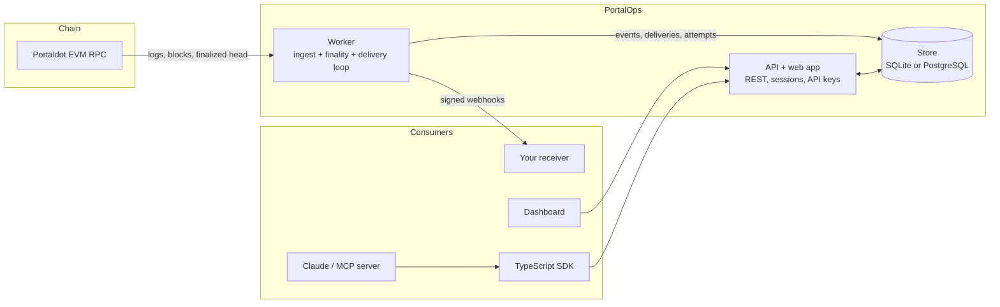

# Architecture

PortalOps is **middleware**: it sits between a blockchain and the applications that care about it, and turns raw chain activity into
reliable, verifiable, replayable notifications. It is built from small modules with narrow interfaces, so each can be replaced or
extended without touching the rest.

## The pieces



| Process / package | Responsibility |
|---|---|
| `apps/worker` | Polls the chain, decodes logs, stores events, promotes finality, runs the delivery loop. Exactly one per database |
| `apps/api` | REST API, auth, ownership rules, rate limits, the built-in test receiver, and static serving of the web app |
| `packages/chain-adapters` | The `ChainAdapter` interface implementation for EVM JSON-RPC |
| `packages/event-engine` | Turns a raw log into a normalised, JSON-safe event with a deterministic id |
| `packages/webhook-engine` | Delivery state machine: signing, sending, retry planning, SSRF guard, replay |
| `packages/database` | The store: all SQL written once, behind a driver interface (SQLite and PostgreSQL) |
| `packages/sdk` | Typed API client and webhook verification |
| `packages/mcp` | The Claude (MCP) server, built on the SDK |
| `packages/examples` | The example contract catalog (source, ABI, deploy command, receiver code) |
| `src/` | The React dashboard, landing page and docs pages |

The API and worker never call each other. They communicate **only through the database** (plus a heartbeat row), which is why they can
run in one container, in two, or on two machines (with PostgreSQL).

## Data flow of one event

```mermaid
sequenceDiagram
  participant C as Chain
  participant W as Worker
  participant S as Store
  participant H as Your webhook
  W->>C: eth_getLogs(from cursor+1 … head, addresses)
  C-->>W: logs
  W->>W: decode with ABI → event (id = hash of project, chain, block, tx, log index)
  W->>S: BEGIN: insert event (ignored if it exists), create deliveries, advance cursor: COMMIT
  loop delivery loop
    W->>S: due deliveries? claim one (lease)
    W->>H: POST signed body
    H-->>W: 2xx / 5xx / timeout
    W->>S: record attempt; delivered, retrying (backoff) or failed
  end
  W->>C: finalized head?
  W->>S: promote verified events to finalized; orphan reorged ones
```

The atomic step matters: **events, their deliveries and the cursor move together or not at all**. A crash can therefore never leave
an event stored without its delivery, or a cursor that skipped an event. Restarting is always safe: re-reading the same range inserts
nothing new because event ids are deterministic.

## Design decisions

| Decision | Why |
|---|---|
| Deterministic event ids that include the block hash | Re-reads are idempotent, and a reorganised log becomes a *different* event instead of silently changing an old one |
| `finalized` comes from the node's own finalized block, verified; never guessed from depth | Depth is a heuristic. Money-moving consumers need an honest signal, so `confirmed` and `finalized` are different words |
| At-least-once delivery with event-id idempotency | Exactly-once over HTTP is not achievable; making duplicates harmless is |
| Replay re-sends the stored event | The chain is the source of truth and is never asked to repeat anything; replay only repairs the *consumer* side |
| Webhook secrets encrypted at rest (AES-256-GCM), shown once | A database leak alone must not let someone forge deliveries |
| SSRF guard at save time **and** send time, pinned to the validated address | DNS can change between the two; a webhook target must never reach internal services |
| Ownership failures are `404`s | Ids cannot be probed for existence |
| API keys scoped to one project, hashed, cannot do account actions | A leaked key has a small blast radius |
| API and worker share only the database | Two small, independently restartable processes; no RPC between them to secure or version |
| Claude tools write secrets to files, never into the conversation | Conversations are logged and shared; env files are the normal place for secrets |

## Extending PortalOps

### A new chain (or a native-runtime source)

Implement `ChainAdapter` (`packages/shared-types/index.ts`) and give the worker an instance:

```ts
interface ChainAdapter {
  readonly chainId: number;
  readonly source: "evm" | "native";
  getHead(): Promise<BlockRef>;                  // { number, hash }
  getBlock(number: number): Promise<BlockRef | null>;   // null when the node no longer has it (pruned)
  getFinalized(): Promise<BlockRef | null>;      // null when there is NO finality signal: never guess
  getLogs(from: number, to: number, addresses?: string[]): Promise<RawEvmLog[]>;
}
```

The ingestion loop, finality promotion, reorg handling and delivery pipeline work against this interface only, and the ingestion tests
run it against an in-memory fake chain that can mine, reorganise, prune and finalize blocks. Throw `BlockUnavailableError`
(`packages/chain-adapters/errors.ts`) from `getBlock` for pruned blocks so the worker can tell "gone" from "failed".

### A different database

Implement `SqlDriver` (`packages/database/driver.ts`): `all`, `run`, `transaction` and `close`, with `?` placeholders. The two existing drivers are
about 100 lines each; the whole store and the whole test suite run on top. Add a schema file for the new dialect and a branch in `openStore`.
The suite runs on SQLite by default and on a real PostgreSQL with `npm run test:pg`: a new driver gets the same ~100 tests for free
(see `packages/database/testing.ts`).

### A different delivery target

Deliveries are rows with a state machine; *sending* is one function (`sendWebhook` in `packages/webhook-engine/send.ts`) that takes a
URL, a body and headers and returns `{ status, errorCode, durationMs, sanitisedResponse }`. A new target type (a queue, an email, a
chat message) means a new sender with the same return shape and a way to select it per endpoint; retry planning, replay, history and the
dashboard already work on that shape.

### A new API client

Everything the dashboard, SDK and Claude server do goes through the public REST API. Another client (a CLI, a different language SDK) needs
only [the API reference](../reference/api.md) and an API key.

## Testing strategy

- **Ingestion** runs against a fake chain (reorgs, pruning, finality, RPC failures, long downtime) and against **real testnet logs**
  (`npm run pipeline:test`).
- **The store** has one suite that runs on SQLite and on real PostgreSQL (`npm run test:pg`), including concurrency tests (identical
  inserts race, one winner; a delivery claimed by many workers has exactly one claimant; transactions roll back completely).
- **The API** is tested over real HTTP with a real store, including ownership, CSRF, rate limits and the receiver.
- **The SDK and the Claude server** are tested against the real API, not mocks of it.
- **The docs** are tested: every route must appear in the API reference, every environment variable in the configuration reference, and
  every relative link must resolve.

## Limits

- One worker per database, and in-memory rate limiters mean one API instance.
- Only the EVM view of the Portaldot V3.0 testnet is ingested; native-runtime events are not.
- No email verification, password reset or OAuth yet; account recovery is manual.
- The Docker image, compose files and Render blueprint have been written and unit-checked but not run on a real host.
